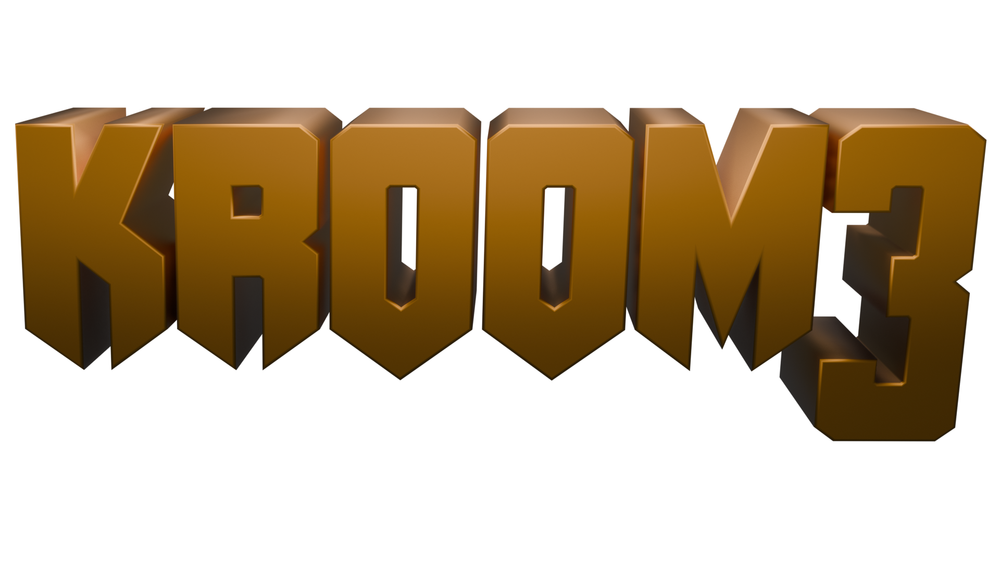

                                      "don't worry, you'll get your product"
                                                                            - Bertruger

Fork of RBDOOM3-BFG v1.3.0 source port aims to modernize DOOM 3 BFG while also trying to mainting the same look of the game but giving more flexibility to modders, successor of D3ModdingKit.

## About the Port

Fork of RBDOOM3-BFG v1.3.0 source port aims to modernize DOOM 3 BFG while also trying to mainting the same look of the game but giving more flexibility to modders, successor of D3ModdingKit.
While this is a D3ModdingKit succesor is not by any means a fully replacement.

# Compiling Instructions

Compiling its straight forward following these steps:

- For Windows 10/11:
  
  * Install Visual Studio 2022 Community Edition With C++ Workspace.
  * For x64/x86 run **cmake_msvc.cmd** bat file.

- For Windows 7 (Untested):
  
  * Install Visual Studio 2019/2017
  * [Download and Install DirectX SDK June 2010](https://www.microsoft.com/en-us/download/details.aspx?id=6812)
  * For x64/x86 run **cmake_msvc.cmd** bat file.

- For Debian base distros
  
  * Install the pre-requirements
    
    ```
    sudo apt-get install -y build-essential nasm pkgconf autoconf libtool libx11-dev libxft-dev libxext-dev libwayland-dev libxkbcommon-dev libegl1-mesa-dev libibus-1.0-dev libglfw3-dev libgl1-mesa-dev libglu1-mesa-dev freeglut3-dev mesa-common-dev libxmu-dev libxi-dev libgl-dev libdecor-0-dev libxrandr-dev libxxf86vm-dev libx11-xcb-dev libxcb-dri2-0-dev libxcb-glx0-dev libxcb-icccm4-dev libxcb-keysyms1-dev libxcb-randr0-dev python3-jinja2 libltdl-dev ninja-build
    ```
  
  * Open a termina in **neo/** folder and run:
    
    ```
    chmod +x cmake_linux.sh
    ```
  
  * In the same terminal run:
    
    ```
    ./cmake_linux.sh gcc debug
    ```
