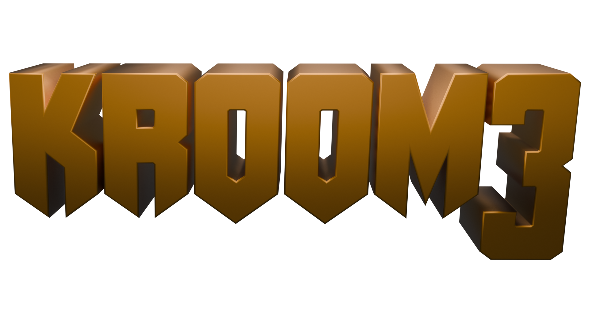

                                      "don't worry, you'll get your product"
                                                                            - Bertruger

# KROOM-3 BFG Edition

KROOM-3 is a fork of the [RBDOOM-3-BFG](https://github.com/RobertBeckebans/RBDOOM-3-BFG) v1.3.0 source port. It aims to modernize DOOM 3 BFG while keeping the look of the game, and to give modders more flexibility.

* Renderer: OpenGL or Vulkan backends the choice it's yours.
  * **NOTE:** Vulkan is very much a work in progress and **NOT** usable at this moment.
* Platform:  SDL2 backend for Windows and Linux.
* Built-in wxWidgets based tools (GUI editor, material editor, script debugger, ect).
* Game code is built as a separate library (`BUILD_GAME_DLL`, on by default).

## Download

Nightly builds are published on the **Releases** page of this repository as a pre-release named `nightly-YYYY-MM-DD`:

| Archive                                         | Platform       |
| ----------------------------------------------- | -------------- |
| `Kroom3BFG-linux-x86_64-<date>-<commit>.tar.gz` | Linux x86_64   |
| `Kroom3BFG-windows-x64-<date>-<commit>.zip`     | Windows 64-bit |
| `Kroom3BFG-windows-x86-<date>-<commit>.zip`     | Windows 32-bit |

There is only ever one nightly: it is replaced by the next one, and the old release and its tag are deleted. Do not link to a nightly release or tag, they disappear.

The archives contain the engine, the game library, the `platform` folder and the licenses. They do **not** contain any of the Doom 3 BFG Edition game data.

## Running

KROOM-3 needs the `base` folder of your own copy of DOOM 3 BFG Edition (Steam App ID 208200 if you want to use DepothDownloader, I wouldn't judge you :P).

* Put the engine and your `base` folder in the same directory, so the layout is `Kroom3BFG(.exe)`, `base/` (game data + the game library) and `platform/`. On Windows the Steam installation is used as a fallback if no `base` folder is found next to the executable.
* Otherwise point the engine at the folder that contains `base` with `+set fs_basepath <folder>` on the command line. `+set fs_game <name>` selects a mod.

## Building

The build is CMake based (CMake 3.20 or newer). The first configure needs an internet connection: the dependencies that are not found on the system are downloaded and built with CMake's FetchContent. Pass `-DUSE_SYSTEM_LIBS=ON` to require system packages instead of downloading them.

The executable is written to `bin/x86_64/` (`bin/x86/` for 32-bit) in the root of the repository and the game library to the `base/` folder inside of it. Run the engine from there, or copy `platform/` next to it.

### Windows 10/11

* Install Visual Studio either 2019, 2022 or 2026 with the *Desktop development with C++* workload.
* Run **cmake_msvc.cmd** from the root of the repository. It detects the newest Visual Studio and the host architecture (x64 or x86), creates `build\msvc<year>-<arch>\` and generates the solution there. Any extra arguments are passed to CMake, for example `cmake_msvc.cmd -DTOOLS=OFF`.
* Open the solution and build, or run `cmake --build build\msvc2022-x64 --config Release`.
* SDL2, SDL2_image, OpenAL Soft and wxWidgets are downloaded and compiled by the first build, which takes a while.

### Windows 7 (untested)

* Install Visual Studio 2019.
* [Download and install the DirectX SDK June 2010](https://www.microsoft.com/en-us/download/details.aspx?id=6812).
* Run **cmake_msvc.cmd** as above.

### Linux (Debian / Ubuntu)

Tested on Ubuntu 24.04 with GCC 13, Clang 18 and wxWidgets 3.2.

* Install the requirements:
  
  ```
  sudo apt-get install -y build-essential clang cmake ninja-build pkgconf nasm \
    libsdl2-dev libsdl2-image-dev libopenal-dev libglew-dev \
    libgl1-mesa-dev libglu1-mesa-dev libwxgtk3.2-dev \
    libzstd-dev zlib1g-dev libx11-dev libxext-dev
  ```

* From the **root of the repository** run:
  
  ```
  chmod +x cmake_linux.sh
  ./cmake_linux.sh <gcc|clang|clang-libc++> <debug|release|reldeb>
  ```
  
  for example `./cmake_linux.sh gcc release`. This configures `build/<compiler>/<type>/` with Ninja.

* Build it:
  
  ```
  cmake --build build/gcc/release
  ```

Without the script:

```
cmake -S neo -B build -G Ninja -DCMAKE_BUILD_TYPE=Release
cmake --build build
```

wxWidgets is required on Linux even with `-DTOOLS=OFF`.

### CMake options

| Option                    | Default | Description                                                                      |
| ------------------------- | ------- | -------------------------------------------------------------------------------- |
| `TOOLS`                   | ON      | Compile the built-in wxWidgets tools                                             |
| `BUILD_GAME_DLL`          | ON      | Build the game as a separate library instead of embedding it in the executable   |
| `USE_PRECOMPILED_HEADERS` | ON      | Precompiled headers. Turn this off when using a compiler cache (ccache, sccache) |
| `USE_SYSTEM_LIBS`         | OFF     | Require system installed libraries instead of fetching them                      |
| `USE_STEAMWORKS`          | OFF     | Steamworks integration (`STEAM_APP_ID`, default 208200)                          |
| `USE_VULKAN`              | OFF     | Vulkan renderer, not usable yet                                                  |
| `FFMPEG`                  | OFF     | Use FFmpeg to play more video formats                                            |
| `ONATIVE`                 | OFF     | Optimize for the host CPU                                                        |
| `REPRODUCIBLE_BUILD`      | OFF     | Replace `__DATE__` and `__TIME__` with fixed values                              |
| `COMPILE_COMMANDS`        | OFF     | Generate `compile_commands.json`                                                 |
| `FORCE_COLOR_OUTPUT`      | OFF     | ANSI colored compiler output (GCC/Clang)                                         |

## Third-party components and licenses

KROOM-3 is licensed under the GNU GPL v3 ([LICENSE.md](LICENSE.md)). Some code is excluded from it, see [LICENSE_EXCEPTIONS.md](LICENSE_EXCEPTIONS.md).

Build dependencies, each under its own license (check their repositories for the exact terms)

## Credits

* [RBDOOM-3-BFG](https://github.com/RobertBeckebans/RBDOOM-3-BFG) by Robert Beckebans and contributors
* DOOM 3 BFG Edition GPL source code by id Software
* See [RELEASE-NOTES.md](RELEASE-NOTES.md) for the upstream RBDOOM-3-BFG release notes
